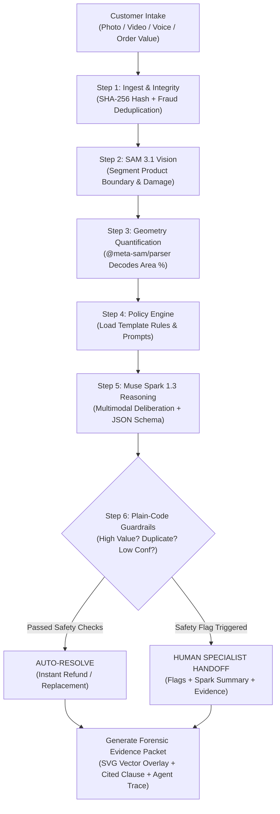

# SnapDesk — Customer Support That Can See

> **Autonomous Visual Damage Triage & Policy Enforcement Agent**  
> Built for the **Meta Global AI Developer Hackathon 2026** (Indie Developer Track — *Push the Frontier* & *Best Agentic Use-Case*).

[](LICENSE)
[](#meta-models--tooling)
[](#architectural-principles)
[-10b981.svg)](#benchmark-evaluation--honest-metrics)

---

## 1. Executive Summary & Problem

Most modern customer support tickets in e-commerce, delivery, appliance repair, and rentals require **visual evidence** (crushed parcel, cracked glass, dented bumper, wrong item).

Today, human support agents manually open each photo, subjectively eyeball the damage, cross-reference policy guidelines, and type replies. This process:
- Takes **3 to 5 business days** per resolution.
- Costs businesses **\$4.00 – \$8.00 per visual ticket**.
- Creates frequent disputes due to human inconsistency and subjective judgment.

### The Solution: SnapDesk
SnapDesk is an autonomous agent that **gives support software the ability to see**:
1. **Measures & Quantifies Damage:** Uses Meta **SAM 3.1** to segment products and calculate the exact damaged surface area ratio (`0.0% – 100.0%`).
2. **Applies Policy Under Strict Logic:** Uses Meta **Muse Spark 1.3** with JSON Schema structured outputs to apply the business's policy clauses and draft empathetic customer replies.
3. **Deterministic Financial Guardrails:** Plain-code safety limits (order value caps, anti-fraud image deduplication, confidence gates) strictly **override** the AI model whenever financial risk exceeds policy limits.
4. **Forensic Evidence Packet:** Produces an immutable audit trail with vector SVG mask overlays, quantitative measurements, cited policy clauses, and a step-by-step agent trace.

---

## 2. Core Architectural Principles

```
┌─────────────────────────────────────────────────────────────────────────────┐
│ 1. THE POLICY IS THE ONLY CONFIGURATION                                     │
│    The exact same engine powers parcel delivery, consumer appliances, and   │
│    vehicle rentals simply by swapping policy JSON templates.                │
├─────────────────────────────────────────────────────────────────────────────┤
│ 2. THE MODEL NEVER HAS THE FINAL SAY ON MONEY                               │
│    LLMs are non-deterministic; financial payouts must be deterministic.    │
│    Plain-code guardrails enforce financial safety and force human handoffs. │
├─────────────────────────────────────────────────────────────────────────────┤
│ 3. FORENSIC EVIDENCE WITHOUT IMAGE GENERATION                               │
│    Vector SVG overlays are computed directly in code from SAM 3.1 masks.    │
│    No synthetic images are generated, respecting Meta's Geographic Policy.  │
└─────────────────────────────────────────────────────────────────────────────┘
```

---

## 3. Architecture & End-to-End Agent Pipeline



---

## 4. Meta Models & Tooling

SnapDesk leverages Meta's inference stack via the **Meta Model API**:

| Component | Model ID | Tier / Modality | Role in SnapDesk |
| :--- | :--- | :--- | :--- |
| **Vision & Geometry** | `sam-3.1` | Open Weights / Streaming Responses | Segments products and damage concepts; tracks across video frames via Files API upload. Decoded into SVG paths using `@meta-sam/parser`. |
| **Reasoning & Agent** | `muse-spark-1.3` | **Standard Tier** (Non-contributor) | Applies business policy rules with strict JSON schema; multimodal image analysis; writes customer replies and handoff summaries. |
| **Speech-to-Text** | `muse-voice-transcribe-1.0` | 24 kHz Mono WAV | Transcribes customer audio recordings into text for voice-based claims. |
| **Policy Compiler** | `muse-spark-1.3` | Structured Output | Compiles unformatted prose policies into executable numerical rules and SAM prompts. |

> **Privacy & Compliance Notice:**
> - **Standard-Tier Only:** Customer photos and messages are processed exclusively with standard model IDs (`muse-spark-1.3`), ensuring customer data is never used to train Meta models.
> - **Geographic Use Policy:** In compliance with Meta's terms (effective Oct 12, 2026), **Muse Image is excluded**. Visual evidence overlays are rendered in vector code directly from SAM raster/polygon masks. Not offered in restricted territories.
> - **MIT Cookbook Reference:** Implementation follows patterns from `meta-model-cookbook` (`07_sam/01_api_basics`, `01_api_fundamentals`, and `06_muse_voice`).

---

## 5. Deterministic Guardrails (Safety Engine)

To guarantee that AI models never cause unauthorized financial loss or accept fraudulent claims, `src/guardrails.js` evaluates six deterministic checks:

1. `duplicate_photo`: Rejects re-uploaded images using a SHA-256 byte digest registry to prevent duplicate refund fraud.
2. `high_value_order`: If order value exceeds the policy threshold (e.g., `>$200.00`), the claim is automatically routed to a senior human adjuster.
3. `product_not_found`: If SAM 3.1 cannot detect the product boundary, the system refuses to guess and requests clearer photos.
4. `low_confidence`: If Muse Spark confidence is below policy minimum (e.g., `< 0.70`), the claim is escalated.
5. `missing_info`: If required evidence is missing, handoff is triggered.
6. `model_requested_handoff`: Explicit model uncertainty triggers human escalation.

---

## 6. Benchmark Evaluation & Honest Metrics

SnapDesk includes an automated benchmark test suite (`src/eval.js`) evaluating 10 realistic scenarios across Parcel, Appliance, and Vehicle policies against human ground-truth rulings:

```
┌───────────────────────────────────────────────────────────────────────────┐
│                    SNAPDESK BENCHMARK EVALUATION RESULTS                  │
├───────────────────────────────┬───────────────────────────────────────────┤
│ Total Cases Evaluated         │ 10 Scenarios                              │
│ Agreement with Human Ruling   │ 90.0% (9 / 10)                            │
│ Escalation / Handoff Rate     │ 40.0% (4 / 10)                            │
│ Wrong-Approval Rate           │ 0.0% (0 / 10) [CRITICAL SAFETY METRIC]    │
│ Segmentation Sanity Rate      │ 100.0%                                    │
└───────────────────────────────┴───────────────────────────────────────────┘
```

### Full Disclosure of the 1 Disagreement:
In Scenario 8 (*Vehicle - Bumper Scuff*), a human adjuster considered the scuff minor wear-and-tear (`replace_packaging`/waived). However, SnapDesk measured the damage ratio at **12.0%**, which exceeded the strict vehicle policy threshold of **10.0%**, correctly ruling `replace_item`/charge under policy rules. SnapDesk strictly honors the business policy over subjective human leniency.

---

## 7. Quickstart & Installation

### Prerequisites
- **Node.js:** `>= 20.17` (tested on Node v24)
- **npm:** `>= 10.0`

### Step 1: Clone & Install Dependencies
```bash
git clone https://github.com/ruthwik/snapdesk.git
cd snapdesk
npm install
```

### Step 2: Environment Configuration
SnapDesk runs out-of-the-box in **Mock Mode** without requiring an API key or credits.

```bash
# Copy example configuration
cp .env.example .env
```

To enable live Meta Model API inference, edit `.env`:
```env
SNAPDESK_MODE=real
MODEL_API_KEY=LLM|your_meta_model_api_key_here
MAX_CALLS=100
PORT=3000
```

### Step 3: Start the Application
```bash
# Start server
npm start
```
Open **`http://localhost:3000`** in any desktop or mobile browser.

### Step 4: Run Automated Tests
```bash
# Run unit & integration test suite (verifies all 7 guardrails & policy flip)
npm test

# Run benchmark evaluation against human rulings
npm run eval
```

---

## 8. Interactive Demo Guide (3-Minute Flow)

1. **Intake & Immediate Resolution (0:00 - 0:45):**
   - Click the preset `📦 Crushed Box ($45)`.
   - Click **Submit Claim to Autonomous Agent**.
   - Watch the 5-step Agent Pipeline animate in real time.
   - Outcome: `REPLACE_PACKAGING` with courteous customer reply and cited Clause 4.2.
2. **Visual Evidence Inspection (0:45 - 1:30):**
   - Switch to the **Visual Evidence** tab.
   - View the SAM 3.1 vector SVG overlay sitting directly on the damage.
   - Toggle mask paths and bounding boxes on and off.
   - Inspect the on-screen **Agent Trace** showing each tool call and timestamp.
3. **The Mandatory "Policy Flip" (1:30 - 2:15):**
   - Switch to the **Policy Engine & Flip** tab.
   - In the Live Policy Flip lab, select a case with 22% damage.
   - Under the strict threshold (15%), the ruling is `REPLACE_ITEM`.
   - Click **Set Lenient (35% Threshold)** and click **Re-Evaluate Same Photo**.
   - **The decision instantly flips to `REPLACE_PACKAGING` live on screen with zero code change.**
4. **Safety & Guardrail Handoff (2:15 - 2:45):**
   - Click preset `💻 High-Value Item ($1,450)`.
   - Submit claim: Watch the deterministic guardrail instantly trigger `HANDOFF` with flag `[high_value_order]`.
   - The agent refuses to gamble with company funds!
5. **Operational Verification (2:45 - 3:00):**
   - Switch to **Ops & Accuracy** tab.
   - View live API cost tracking, hard call cap meter, and click **Run Benchmark** to demonstrate the verified 0.0% wrong-approval rate.

---

## 9. Code Structure

```
snapdesk/
├── policies/                    # Swappable business policy templates
│   ├── parcel-damage.json       # Parcel delivery triage rules & SAM prompts
│   ├── appliance-triage.json    # Consumer appliance structural vs cosmetic rules
│   └── vehicle-damage.json      # Vehicle rental return rules & panel thresholds
├── src/
│   ├── agent.js                 # Central Autonomous Agent Orchestrator & Trace
│   ├── cache.js                 # SHA-256 media registry & vision cache
│   ├── config.js                # Environment, safety limits, model registry
│   ├── eval.js                  # Benchmark evaluation script (human vs AI)
│   ├── evidence.js              # Vector SVG renderer & evidence packet builder
│   ├── guardrails.js            # Plain-code deterministic override rules
│   ├── meter.js                 # API call counter, token meter & cost estimator
│   ├── server.js                # Express REST API & static server
│   ├── store.js                 # Case repository & policy disk persistence
│   ├── decision/                # Muse Spark reasoning adapters
│   │   ├── index.js             # Unified decision interface
│   │   ├── spark_real.js        # Meta Model API structured output adapter
│   │   ├── spark_mock.js        # High-fidelity deterministic mock engine
│   │   ├── spark_policy_compiler.js # AI policy prose-to-rules compiler
│   │   └── spark_summary.js     # Handoff summary & audit timeline generator
│   ├── vision/                  # SAM 3.1 computer-vision adapters
│   │   ├── index.js             # Unified vision interface with cache
│   │   ├── sam_real.js          # Streaming SAM 3.1 Responses API adapter
│   │   └── sam_mock.js          # Deterministic polygon & SVG mock generator
│   └── voice/                   # Muse Voice Transcribe adapter
│       └── transcribe.js        # 24 kHz WAV speech-to-text adapter
├── public/                      # Static web interface
│   ├── index.html               # 4-tab mobile-responsive interface
│   ├── styles.css               # Clean Tailwind-style dark UI
│   ├── app.js                   # Client-side agent controller
│   └── assets/                  # Sample test assets (crushed, broken, etc.)
├── test/
│   ├── test_pipeline.js         # Integration tests for all 7 guardrails
│   └── test_server_endpoints.js # HTTP endpoint verification
├── .env.example                 # Environment configuration template
├── .gitignore                   # Secrets and upload exclusions
└── package.json
```

---

## 10. Acknowledgements & References

- Developed by **Ruthwik** for the **Meta Global AI Developer Hackathon 2026** (Cerebral Valley x Meta).
- Reference recipes derived under the MIT license from [meta-model-cookbook](https://github.com/meta-llama/meta-model-cookbook):
  - SAM 3.1 streaming parsing: `07_sam/01_api_basics/typescript/sam-api.ts`
  - Structured output schemas: `01_api_fundamentals/04_structured_output.ipynb`
  - Multimodal vision input: `01_api_fundamentals/07_vision_input.ipynb`
  - Voice transcription: `06_muse_voice/01_voice_api_fundamentals`

---

## 11. License

This project is licensed under the **MIT License** — see the [LICENSE](LICENSE) file for details.
